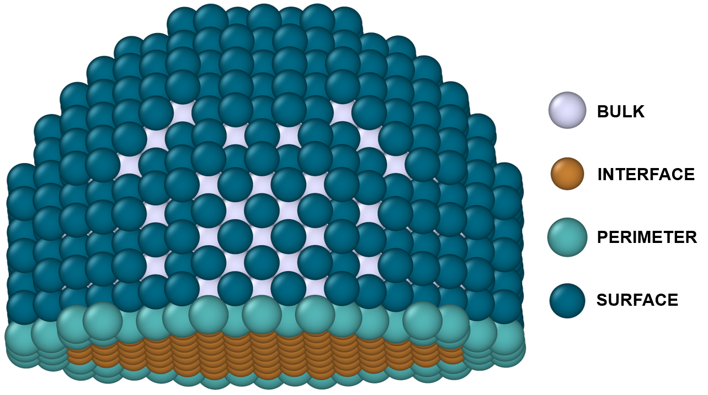
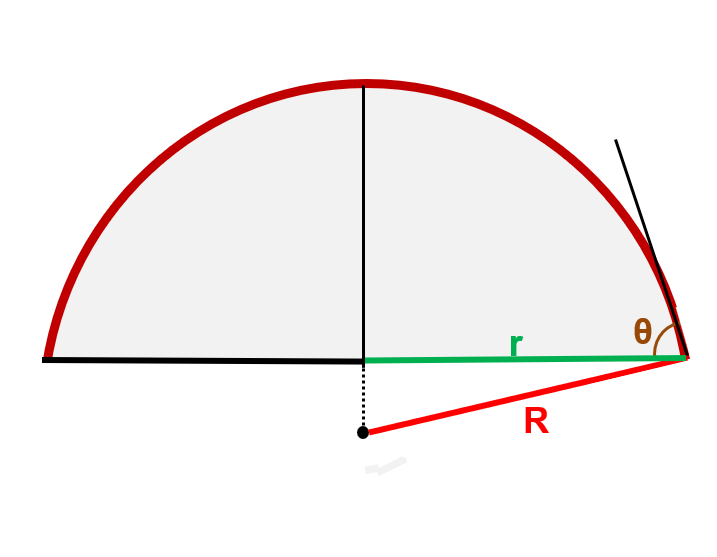
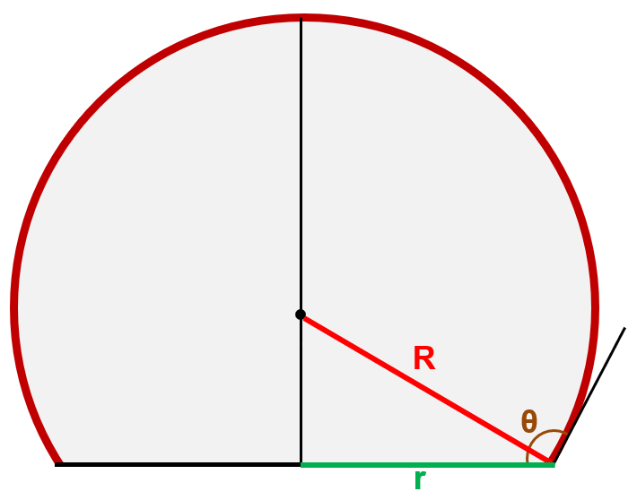

NanoparticleAtomCounter
=======================

**From TEM-derived nanoparticle geometry to quantitative catalytic site populations.**

|web-badge| |pypi-badge| |license-badge| |paper-badge|

NanoparticleAtomCounter is an open-source research tool for estimating the
number of atoms in supported monometallic nanoparticles from their radius,
contact angle and elemental composition. It approximates each particle as a
spherical cap, avoiding the need to construct explicit atomistic models.

**Try the free** `interactive web application`_ **. No installation required.**
For automated analysis and integration into research workflows, use the
`Python package`_ or command-line interface (CLI).

   Atom populations in a supported nanoparticle. The support is omitted.

Scientific applications
-----------------------

* Estimate metal dispersion and exposed metal atom populations.
* Compare surface, interfacial and perimeter populations across catalysts.
* Investigate how particle size, wetting and morphological evolution affect
  the abundance of different site types.
* Estimate site populations for turnover-frequency (TOF) normalization,
  where the relevant active-site type is independently established.
* Convert experimental geometry datasets into atom-count distributions for
  statistical analysis and comparison with atomistic simulations.

The software estimates geometric site populations; it does not identify
catalytically active atoms, extract measurements directly from TEM images,
or calculate reaction rates or TOFs by itself.

Quick start: web application
-----------------------------

Open https://nanoparticleatomcounter.streamlit.app/ and choose a workflow:

**Single nanoparticle**

#. Select a metal element and choose the footprint or curvature radius.
#. Enter the radius (Å or nm) and contact angle (degrees).
#. Choose the counting method and optionally specify crystallographic facets.
#. Calculate the atom populations and inspect the geometry, schematic,
   population breakdown and downloadable results.

For a quick demonstration, select the built-in Pt example with a footprint
radius of 25 Å and a contact angle of 109°.

**Batch analysis**

#. Upload a CSV or Excel dataset, or select the built-in example.
#. Preview the input and choose a counting method.
#. Calculate all particles, explore the population distributions, and export
   the results as CSV.

A blank template and `sample input dataset`_ are available. Batch radii must
be supplied in Å. Excel input uses the first worksheet.

Geometry and input format
-------------------------

The required inputs for each nanoparticle are the chemical element, contact
angle, and either the footprint radius or the radius of curvature.

.. list-table:: Spherical-cap geometry
   :header-rows: 1
   :widths: 50 50

   * - Acute contact angle (θ < 90°)
     - Obtuse contact angle (θ > 90°)
   * - |acute|
     - |obtuse|

The footprint radius *r* is half the particle–support contact width. The
curvature radius *R* is the radius of the sphere defining the cap. The
contact angle θ is measured through the nanoparticle at its contact with
the support. The two radii are related by **r = R sin θ**.

.. list-table:: Input columns
   :header-rows: 1
   :widths: 24 48 28

   * - Column
     - Meaning
     - Requirement
   * - ``r (A)``
     - Footprint radius in Å
     - Either r or R
   * - ``R (A)``
     - Curvature radius in Å
     - Either r or R
   * - ``Theta``
     - Contact angle in degrees (strictly between 0 and 180)
     - Required
   * - ``Element``
     - Chemical symbol, e.g. Pt, Ag or Ni
     - Required
   * - ``Interface Facet``
     - Crystal plane at the particle–support contact, e.g. (1, 1, 1)
     - Optional where a default exists
   * - ``Surface Facet``
     - Representative exposed crystal plane, e.g. (1, 0, 0)
     - Optional where a default exists

Example CSV (save as ``input.csv``):

.. code-block:: text

   r (A),R (A),Theta,Element,Interface Facet,Surface Facet
   25,,109,Pt,,
   30,,95,Ag,"(1,1,1)","(1,0,0)"
   40,,120,Au,,

Use positive radius values. If both radii are supplied, the footprint radius
normally takes precedence. Facets are three integer Miller indices; fields
containing commas must be quoted in CSV files. Use facets supported by the
package for the selected element. Leaving a facet blank uses the package's
default where available.

For maximum compatibility with the CLI, retain all six headers, even when
some columns are empty, and use the same radius definition for all rows.
The web app also supports mixed radius definitions within a dataset
and fills in omitted optional columns before calling the CLI.

Understanding the results
-------------------------

.. list-table:: Estimated atom populations
   :header-rows: 1
   :widths: 25 75

   * - Population
     - Definition
   * - Total
     - All atoms in the nanoparticle (excluding the support).
   * - Surface
     - Exposed nanoparticle atoms outside the nanoparticle-support interface.
   * - Interfacial
     - Atoms of the nanoparticle-support interface, excluding the perimeter.
   * - Perimeter
     - Atoms along the exposed outer boundary of the nanoparticle-support interface.
   * - Bulk
     - Remaining interior atoms, excluding the Surface, Interfacial, and Perimeter site populations.

The CLI returns ``Perimeter``, ``Interface``, ``Surface`` and ``Total``.
The web app additionally reports the estimated bulk population, calculated as

**Bulk = Total − Surface − Interface − Perimeter.**

For physically consistent populations, the web app provides percentage
breakdowns, charts and the corresponding input information in the exported
CSV. Nonphysical partitions are flagged rather than silently corrected.

Counting methods and limitations
--------------------------------

Two analytical counting methods are available:

* **Volume (default):** estimates the interfacial and perimeter populations
  from the volumes of their respective regions and bulk atomic density.
* **Area:** estimates the interfacial and perimeter populations from their
  footprint areas and facet-dependent planar atomic density. At fixed footprint
  radius and interface facet, the interfacial and perimeter populations are
  independent of contact angle in this mode.

Both modes estimate the total population from the spherical-cap volume and
use the exposed surface area to estimate the surface population.

The model assumes a supported monometallic spherical-cap particle, with
material properties derived from bulk reference data. Its accuracy may
be reduced for strongly faceted or irregular shapes, reconstructed or
strained structures, and very small nanoparticles. Consult the
`preprint`_ for the derivation, benchmarking and applicability of the model.
Benchmark and test routines are included in the repository.

Installation: command line and Python
--------------------------------------

I recommend creating a dedicated environment before installing:

.. code-block:: bash

   conda create -n nac python=3.12 pip
   conda activate nac
   python -m pip install NanoparticleAtomCounter

Alternatively, install by:

.. code-block:: bash

   git clone https://github.com/szilvasi-group/NanoparticleAtomCounter.git
   cd NanoparticleAtomCounter
   python -m pip install -e .

Command-line usage
~~~~~~~~~~~~~~~~~~

.. code-block:: bash

   nanoparticle-atom-count -i input.csv -o output.csv -m volume
   nanoparticle-atom-count -i input.csv -o output_area.csv -m area
   nanoparticle-atom-count --help

The CLI accepts CSV, XLS and XLSX files and writes a CSV containing the four
original atom-count columns, in the same row order as the input.

Python usage
~~~~~~~~~~~~

You can use the calculation functions directly in your Python scripts:

.. code-block:: python

   from NanoparticleAtomCounter.by_volume import calculate_by_volume

   perimeter, interface, surface, total = calculate_by_volume(
       element="Pt",
       footprint_radius=25.0,  # Å
       theta=109.0,           # degrees
       interface_facet=(1, 1, 1),
       surface_facet=(1, 1, 1),
   )

   bulk = total - surface - interface - perimeter
   print(total, bulk, surface, interface, perimeter)

For the area-based alternative, import ``calculate_by_area`` from
``NanoparticleAtomCounter.by_area``. The same input arguments and return
order apply.

Tests and benchmarks
--------------------

Install and run the test suite:

.. code-block:: bash

   python -m pip install "NanoparticleAtomCounter[test]"
   atom-count-test

Install the benchmark dependencies and run the benchmark:

.. code-block:: bash

   python -m pip install "NanoparticleAtomCounter[benchmark]"
   atom-count-benchmark

Citation
--------

If NanoparticleAtomCounter contributes to your research, please cite the
associated ChemRxiv preprint:

   Olajide, G.; Szilvási, T. *NanoparticleAtomCounter: A Python/Web-based
   package to convert nanoparticle geometry from Transmission Electron
   Microscopy into atom counts.* ChemRxiv.
   https://doi.org/10.26434/chemrxiv.15001082/v1

Feedback and contributions
--------------------------

Questions, bug reports, feature requests and feedback from experimental or
computational researchers are welcome. If you encounter a problem, please
include the software version, counting method and a minimal reproducible
example (without confidential data).

* `Open a GitHub issue`_.
* Contact me at: giolajide@crimson.ua.edu.

Authors and license
-------------------

Developed by **Gbolagade Olajide and Tibor Szilvási**, Department of Chemical
and Biological Engineering, The University of Alabama.

Released under the `MIT license`_.

.. |web-badge| image:: https://img.shields.io/badge/Web%20app-Open%20calculator-176B87
   :target: https://nanoparticleatomcounter.streamlit.app/
   :alt: Open the web calculator
.. |pypi-badge| image:: https://img.shields.io/pypi/v/NanoparticleAtomCounter
   :target: https://pypi.org/project/NanoparticleAtomCounter/
   :alt: PyPI version
.. |license-badge| image:: https://img.shields.io/badge/License-MIT-green
   :target: https://github.com/szilvasi-group/NanoparticleAtomCounter/blob/main/LICENSE
   :alt: MIT license
.. |paper-badge| image:: https://img.shields.io/badge/Preprint-ChemRxiv-B52F42
   :target: https://doi.org/10.26434/chemrxiv.15001082/v1
   :alt: ChemRxiv preprint

.. _interactive web application: https://nanoparticleatomcounter.streamlit.app/
.. _Python package: https://pypi.org/project/NanoparticleAtomCounter/
.. _sample input dataset: https://github.com/giolajide/NanoparticleAtomCounter/blob/main/docs/sample_input.csv
.. _preprint: https://doi.org/10.26434/chemrxiv.15001082/v1
.. _CITATION.cff: https://github.com/giolajide/NanoparticleAtomCounter/blob/main/CITATION.cff
.. _Open a GitHub issue: https://github.com/giolajide/NanoparticleAtomCounter/issues
.. _non-tracking URL: https://nanoparticleatomcounter.streamlit.app/?test=1
.. _MIT license: https://github.com/szilvasi-group/NanoparticleAtomCounter/blob/main/LICENSE
